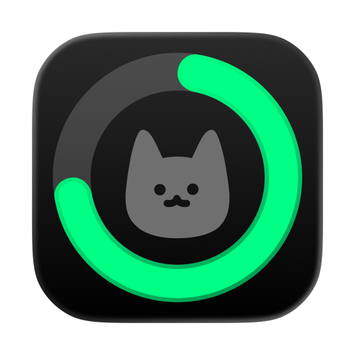

> Latest delivery: macOS **1.3.8 (1.3.8)** is available to the current tester in TestFlight, verified on October 19. It keeps the Dock icon and existing design while displaying the timer over native full-screen apps. [TestFlight evidence](docs/release/2026-10-18/testflight-1.3.8/README.md). Public App Store submission of 1.3.8 is waiting for App Store Connect sign-in; it has not been submitted. [Public release handoff](docs/release/2026-10-19/macos-1.3.8/README.md). The earlier macOS 1.3.7 and iOS 0.1.0 (12) submissions were waiting for review when last checked on October 18; their current public availability has not been reverified.

# NeowFocus 🐱⏱️


<div align="center">



**A Pomodoro Timer with Cute Cat Companion**

[](https://www.electronjs.org/)
[](https://reactjs.org/)
[](https://www.typescriptlang.org/)
[](https://www.apple.com/app-store/)

**[English](#)** | **[한국어](./README.ko.md)**

</div>

---

## 🎯 Overview

NeowFocus is a Pomodoro timer application for macOS that helps users maintain focus and boost productivity. Complete focus sessions and collect cute cat paw stamps as visual rewards for your accomplishments!

## ✨ Key Features

- 🎯 **Pomodoro Timer**: Efficient 25-minute focus sessions with customizable durations
- 🐾 **Cat Paw Animation**: Adorable paw stamp effect upon session completion
- 📌 **Always-on-Top Mode**: Floating timer stays visible above all windows
- 🪟 **Tiny Window Mode**: Minimized compact view for space efficiency
- 🎨 **Beautiful Design**: Polished UI based on professional Figma design system
- 💾 **Auto-Save**: Automatic persistence of tasks and timer state
- 🔔 **System Tray Integration**: Quick access from menu bar
- ⌨️ **Keyboard Shortcuts**:
  - `Cmd+W` to hide window
  - `Cmd+Q` to quit application
  - Focus mode disables certain shortcuts to minimize distractions
- 🌙 **Dark Mode**: Native macOS dark theme support
- 🍎 **Mac App Store Ready**: Fully sandboxed and compliant with App Store guidelines

## 📱 How to Use

### 1. Start a Focus Session
- Launch NeowFocus from your Applications folder or menu bar
- Enter your task name (optional)
- Click the timer to start your 25-minute focus session

### 2. During Focus
- The timer stays always-on-top so you can see your remaining time
- Switch to Tiny Window mode for a minimal view
- Focus mode prevents accidental interruptions

### 3. Complete Session
- When the timer ends, you'll see a cute cat paw stamp animation
- Collect paw stamps as you complete more sessions
- Your progress is automatically saved

### 4. System Tray
- Click the tray icon to show/hide the main window
- Right-click for quick access to menu options
- Use Dock menu to open, hide, or quit the app

## 🛠 Technical Stack

- **Framework**: Electron 28.x + React 18.x
- **Language**: TypeScript 5.x
- **Build Tools**: Vite + electron-vite + @electron/forge
- **Styling**: styled-components with theme system
- **State Management**: React Context API + localStorage
- **Packaging**: Apple's official @electron/forge

## 🔒 Privacy & Permissions

NeowFocus respects your privacy:
- **Local by default**: Tasks and timer data stay on your device until you opt into iCloud sync.
- **Optional iCloud sync**: When enabled, focus sessions and records are sent to your Apple account’s private CloudKit database. Local timing still works offline.
- ✅ **No third-party analytics**: Zero tracking or telemetry
- ✅ **Sandboxed**: Fully compliant with Mac App Store security requirements
- ✅ **No background services**: Only runs when you're actively using it

### Required Permissions
- The local timer needs no account. Notifications, Live Activities, iCloud sync and optional Screen Time blocking have separate system permissions and release requirements; see the implementation handoff.

## 🚀 Installation

### From Mac App Store (Recommended)
Coming soon to Mac App Store!

### Manual Installation
```bash
# Clone repository
git clone https://github.com/your-repo/NeowFocus.git

# Install dependencies
pnpm install

# Run in development mode
pnpm run dev

# Build for production
pnpm run build:mas
```

## 💡 Tips

- **Keyboard Shortcut**: Press `Cmd+W` to quickly hide the window and return to work
- **Tiny Window**: Perfect for keeping track of time without blocking your workspace
- **Menu Bar Access**: Click the tray icon anytime to bring the window back
- **Persistent Tasks**: Your last task name is automatically saved and restored

## 🆘 Support

If you encounter any issues or have questions:

- 📧 Email: <ahhancom@gmail.com>

## 🔐 Privacy Policy

- [Privacy Policy](https://jamkim.notion.site/2855072e39f5807596d0c4a8de4ebf88)

## 📋 System Requirements

- macOS 11.0 (Big Sur) or later
- Apple Silicon (M1/M2/M3) or Intel processor
- 100 MB free disk space

## 📄 License

Copyright © 2025 NeowFocus. All rights reserved.

## 🤝 Contributing

Bug reports and feature suggestions are welcome through GitHub Issues.

---

<div align="center">

Made with ❤️ and 🐱

**Version 1.1.0**

</div>
