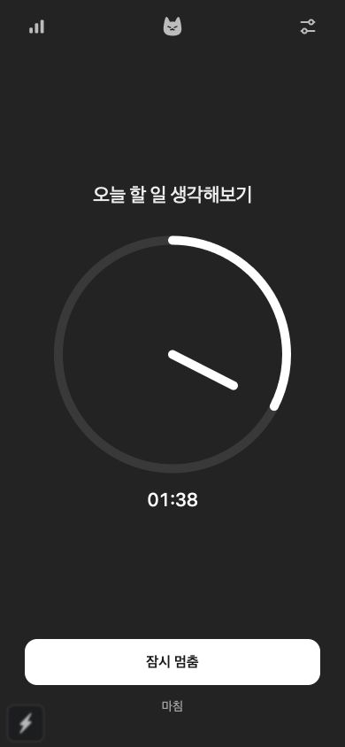

# 전체 화면 패널 구현 추가 — 2026-10-18

Dock 아이콘과 기존 디자인을 유지하는 macOS 패널 창을 구현했다. 실제 Mac에서 별도 전체 화면 앱과 동시 표시·입력·작은 창·숨김/복귀를 검증했고 타입 검사·PC 43 tests·production build를 통과했다. [구현과 증거](fullscreen-panel.md). 사용자 요청으로 PC **1.3.8 (1.3.8)**에 포함해 17:44:27 KST TestFlight 업로드 성공과 Apple 처리 시작을 확인했다. 2026-10-19 실제 Mac TestFlight 앱에서 1.3.8의 ‘업데이트’ 버튼을 확인해 처리 완료·현재 테스터 계정 설치 가능 상태를 검증했다. 새 버전 설치 후 실행은 아직 미확인이다. [TestFlight 기록](../release/2026-10-18/testflight-1.3.8/README.md). 기존 공개 심사 제출은 이번 작업에서 수정하지 않았다.

# 공개 심사 제출 완료 — 2026-10-18

macOS **1.3.7(1.3.7)**와 iOS **0.1.0(12)** 모두 01:07 KST 공개 심사 접수 완료 / 심사 대기 중. 승인 후 자동 출시 설정이다. PC 완료 버튼 문구 변경과 iOS Screen Time API 제거·정책/문의 보완을 포함하며, 공개 개인정보처리방침도 승인 후 갱신했다. [최신 상태와 증거](../release/2026-10-18/README.md)가 아래 날짜별 이력보다 우선한다. 실제 공개 출시·새 버전 실기기 확인은 아직 완료되지 않았다.

# 2026-10-17 — iOS 심사 2.5.1 수정 중

iOS 빌드 9는 불필요한 Screen Time API 포함으로 거절됐다. 관련 코드·링크·권한을 제거하고 개인정보 안내/문의 경로를 보완한 최종 빌드 12의 아카이브·실제 바이너리·서명 검사를 통과했다. Xcode 업로드 인증 실패 및 웹 로그인 만료로 업로드·재제출은 대기 중이다. 재심사 제출은 아직 완료되지 않았다. [현재 수정·검증·출시 상태](../release/2026-10-17/README.md)가 아래 이력보다 우선한다.

# 공개 심사 제출 완료 — 2026-10-16

사용자가 확인한 수정본 **macOS 1.3.6(1.3.6), iOS 0.1.0(9)**를 새로 빌드·서명·업로드했다. Apple 처리 후 21:02 / 21:03 KST 각각 공개 심사 제출 완료 / 심사 대기 중을 확인했다. 승인 후 자동 출시 설정이며 현재 공개 노출·사용자 설치 완료는 아니다. PC 기존 디자인 복원 및 하루 마무리 제거, 두 플랫폼 첫 안내 제거를 포함한다. 모바일 하루 마무리 픽셀 고양이와 기본 꺼짐 자동 휴식은 유지한다. [최신 출시 기록과 제출 증거](../release/2026-10-16/README.md)가 아래 이력보다 우선한다.

# 최신 사용자 결정 — 2026-10-16

PC 디자인을 기존 입력·집중·완료 화면으로 복원했다. **PC의 ‘오늘은 여기까지’·하루 요약·픽셀 고양이는 제거했고 모바일에만 유지한다.** 첫 안내는 두 플랫폼에서 제거했다. PC 자동 10분 휴식/연결 기능은 유지한다. 전체 타입 검사·PC 43 tests·실제 Mac 개발 앱 흐름 확인 완료. iOS 빌드 8은 업로드됐지만 첫 안내 제거 전이므로 공개 심사에 사용하지 않는다. PC 1.3.5도 수정 전 아카이브다. [PC 복원 범위와 증거](pc-design-rollback.md), [출시 준비 상태](../release/2026-10-16/README.md)가 아래 이력보다 우선한다.

# 실제 앱 빌드와 업로드 상태 — 2026-10-15

자동 10분 휴식을 iOS 0.1.0(8) 실제 앱/위젯과 PC 1.3.5에 포함했다. iOS Release 아카이브·Hermes 번들의 기능/이미지 포함·서명 검증 완료. 두 플랫폼 TestFlight 업로드를 시도했으나 Xcode Apple 계정 인증 오류로 export 실패. **새 빌드는 아직 업로드되지 않았으며 사용자 설치 앱 업데이트도 미확인**. 기존 Apple 계정을 Xcode Settings → Accounts에서 재로그인한 뒤 보관한 아카이브로 재개한다. [iOS 상태](../../apps/mobile/scripts/RELEASE-STATUS.md), [PC 상태](desktop-release.md). 아래 배포 전/웹 검증 설명은 이전 단계의 기록이다.

# 자동 10분 휴식 추가 — 2026-10-15

PC·모바일 설정에 기본 꺼짐인 자동 휴식을 추가했다. 켜두면 집중 완료 뒤 10분 휴식, 재실행 시 남은 시간 복원, 중간 종료와 하루 마무리 지원. PC 43 / 공통 79 tests 및 전체 타입·웹 빌드·미리보기 검증 통과. 아직 새 TestFlight 배포 전이다. [자동 휴식 구현·검증](auto-break.md). 아래 1.3.4 아카이브는 휴식 추가 전이며 PC 소스 버전은 1.3.5이다.

# 최신 PC 구현 — 2026-10-15

PC 집중·성취 화면과 Chrome 사이트 차단을 1.3.4 소스에 반영했다. 테스트·브라우저 미리보기·universal 패키징·배포 서명 검증 완료. Mac 잠금으로 실제 앱 소리/햅틱과 Chrome 확장 설치·권한·차단은 미확인이다. 1.3.4는 아직 업로드하지 않았다. [PC 구현과 남은 검증](focus-achievement-desktop.md)을 우선 참고한다. 아래 PC 미변경 설명은 모바일 배포 당시의 이력이다.

# 최신 모바일 배포 — 2026-10-14 22:53 KST

모바일 집중·성취 흐름을 0.1.0(7)로 TestFlight 업로드했다. 일반 완료는 기존 발자국, ‘오늘은 여기까지’에서만 8방향 픽셀 고양이와 픽셀 도장. ARCHIVE SUCCEEDED / Upload succeeded / EXPORT SUCCEEDED 확인. Apple 처리·테스터 표시·실기기 검증은 미확인. PC 화면은 이번 작업에서 변경하지 않았으며 PC 재배포는 하지 않았다. [현재 모바일 구현](focus-achievement-mobile.md), [iOS 배포 상태](../../apps/mobile/scripts/RELEASE-STATUS.md)를 우선 참고한다. 이하 과거 기록의 모바일 UI·배포 상태는 해당 시점의 이력이다.

# 최신 작업 — 2026-10-14 변경 알림

별도 서버 없이 CloudKit 변경 알림 방식으로 전환. 완료 소리/진동과 모바일 발도장 애니메이션 추가. iOS 0.1.0(4) 및 PC 1.3.3(1.3.3) TestFlight 업로드 완료. 실제 기기 간 push 전달 검증은 미완료. 상세 구현·제한은 [변경 알림 인수인계](cloudkit-change-notifications.md)를 우선 참고한다. 모바일 타이머 비율 시안은 검토용이며 앱 미적용.

# 최신 상태 — 2026-10-14

PC 첫 작업 제안은 사용자 요청으로 제거한다. 새 UI는 승인된 차콜 설정/토글/구분선 방향으로 적용했다. CloudKit Production 스키마 배포 후 설치 앱 연결 정상 확인. iOS 0.1.0(3) 수정본 업로드 완료. PC 1.3.2(1.3.2) 업로드 완료. 자세한 검증 범위는 [실기기 피드백 수정](postflight-fixes.md)을 우선 참고한다. 아래 이전 구현 기록의 PC 첫 제안 설명은 더 이상 적용하지 않는다.

# A UX · 동기화 구현 인수인계

기준: 2026-10-13 사용자 승인 — 기존 디자인을 유지하고 A안 UX와 정리한 기획을 실제 앱에 구현. 작업 저장소는 `NeowFocus`, 기획 원본은 옆 폴더 `../design-previews/neowfocus/release-plan.html`이다.

## 현재 결과

차콜, 기존 고양이·발바닥, 흰 원형 타이머를 유지했다. 모바일은 준비 → 집중 ↔ 잠시 멈춤 → 완료 한 화면으로 바뀌고 숫자는 보조 크기로 내려갔다. 기록·설정은 필요할 때 여는 패널이다. 데스크톱은 기존 가로 배치·작은 창·입력/집중 창 크기를 유지한다.

- 오늘 첫 집중에만 ‘오늘 할 일 생각해보기 · 5분’ 제안. 선택하면 입력만 채우며 자동 시작하지 않는다. 입력·건너뛰기·당일 기록·삭제한 당일 기록·이미 처리한 제안이 있으면 반복하지 않는다. 동기화 켠 기기는 처음 연결 확인 전 제안하지 않는다.
- 맥과 모바일 모두 공유 `FocusState` 사용. 종료 시각으로 남은 시간 계산, 논리 버전, 중복 저장 방지, 삭제/복구, 완료 화면 닫힘 및 제안 처리 정보를 유지한다.
- iCloud는 기본 꺼짐. 동일 Apple 계정의 private CloudKit record를 명시적으로 연결. 앱 상태를 바꿀 때 전송하고, 맥 5초·모바일 전경 10초 간격으로 확인한다. 연결 실패에도 로컬 타이머/기록을 유지하고 재시도 가능하다. 연결 해제는 로컬 기록을 지우지 않는다.
- 서로 다른 오프라인 집중이 합쳐지면 선택을 요청한다. 선택하지 않은 집중도 기록에 보존한다. 서버 데이터는 읽었던 changeTag가 일치할 때만 쓰며, 충돌이면 다시 읽고 합친다.
- 위젯/Live Activity용 App Group snapshot, 홈 소형·중형 및 잠금화면 위젯, Live Activity. 작업명은 잠금화면에서 기본 숨김. iOS 17 이상 중형 위젯에서 멈춤/재개.
- 위젯 명령은 로컬에 먼저 저장한 뒤 CloudKit에 원본 세션과 함께 기록한다. 폰을 열면 JS가 같은 명령을 공통 상태로 재생·저장한 후 큐를 확인 처리한다. 중복·역순 수신에 대한 코어 테스트가 있다.
- 완료 알림은 집중을 시작한 기기가 담당. 위젯 조작 후 알림 종료 시각도 재예약한다.
- 선택 앱 차단의 권한·앱 선택·shield·해제 monitor 구현. **배포 권한 미확인으로 `familyControls:false`이며 실제 차단은 비활성 상태.** 타이머는 사용할 수 있다. 차단 시작 때 15분보다 긴 시간이 남아야 하며, 해제 예약 실패 시 차단하지 않는 방식을 사용한다.

## 완료로 간주하면 안 되는 부분

1. **잠긴 폰에 맥의 시작·멈춤·종료를 즉시 전달하는 수신 경로는 아직 없다.** ActivityKit APNs token 등록, 인증된 푸시 서버, 재시도/만료 정책이 필요하다. 현 구현은 전경 동기화 및 위젯에서 밖으로 보내는 변경이다. ‘실시간 동기화 완성’이라고 안내하지 않는다.
2. Live Activity 숫자 카운트다운은 OS가 그린다. 원형 위젯은 timeline에 따른 갱신이며 매초 새로 그리지 않는다. 완료 후 5분 정리는 앱이 완료 처리를 실행할 때 요청한다. 앱이 멈춘 상태에서 정확한 시각에 종료·제거되는 것은 보장하지 않는다.
3. Apple Developer의 App Group/CloudKit container·앱 및 위젯 ID·프로비저닝·Production schema 설정, 실제 두 기기 통신은 아직 검증하지 않았다. 시뮬레이터 컴파일과 JS 테스트가 이를 대신하지 않는다.
4. Screen Time Family Controls 배포 승인은 아직 확인하지 않았다. 권한 회수·강제 종료·재부팅·오프라인의 차단 해제는 실기기 검증을 통과하기 전 활성화하지 않는다.
5. 2026-10-13 23:08 KST 새 iOS 0.1.0(2) 아카이브 업로드 성공. Apple 처리 중이며 테스터 설치 가능·실기기 실행은 미확인. PC 1.3.1(빌드 1.3.1)도 23:43 KST 업로드 성공. 두 플랫폼 모두 Apple 처리 응답까지 확인했으며 테스터 설치 가능 여부는 미확인이다. [iOS 배포 상태](../../apps/mobile/scripts/RELEASE-STATUS.md), [PC 배포 상태](desktop-release.md).
6. 현재 private CloudKit 단일 document는 900 KB 제한으로 보호한다. 초과 시 잘라 버리지 않고 오류를 표시한다. 장기 기록/명령/삭제 이력의 분할 저장·안전한 압축은 후속 과제다.

## 파일 위치

| 범위 | 핵심 파일 |
|---|---|
| 공유 상태/충돌/명령 | `packages/core/src/{store,sync,nativeCommands,envelope,replicator}.ts` |
| 모바일 A 화면 | `apps/mobile/src/app/index.tsx`, `src/ui/*` |
| 모바일 연결 | `apps/mobile/src/focus/{FocusProvider,IntegrationSettings,SyncConflict}.tsx` |
| iOS 네이티브 소스 | `apps/mobile/modules/neowfocus-native/ios/*` |
| Widget/monitor 원본 | `apps/mobile/native-sources/*` |
| 재생성 플러그인 | `apps/mobile/plugins/withNeowFocusNative.cjs` |
| 데스크톱 상태/이관 | `apps/desktop/src/renderer/src/context/{TaskContext.tsx,desktopFocusStorage.ts}` |
| 맥 CloudKit | `apps/desktop/native/focus-cloud.mm`, `src/main/focusCloud.ts`, `scripts/build-cloud-native.sh` |

`apps/mobile/ios/`는 Expo 생성물이다. 수정은 모듈 원본/플러그인에서 한다. CloudKit 계약은 container `iCloud.com.neowfocus.pomodorotimer`, private default zone, type `NeowFocusState`, ID `focus-state-v1`, field `json`, `{schemaVersion:1,state}`이다.

맥 네이티브는 Node-API addon으로 호스트 앱의 CloudKit entitlement를 사용한다. 별도 비밀키·로그인 서버를 요구하지 않는다. 권한이 없는 개발 Electron에서는 동기화가 비활성이다. `build:cloud-native`가 arm64/x86_64 universal 바이너리를 만들고 Forge package hook에 포함한다. Node-API 헤더가 없으면 `NODE_HEADERS`로 경로를 지정한다.

기존 데스크톱 기록과 session 원본은 `neowfocus.legacy.backup.v1`에 백업하고 새 `neowfocus.focus.v1` 상태로 이관한다. 기존 taskList/focusSession 사본도 유지한다. 이해하지 못하는 새로운 저장 스키마는 빈 상태로 덮어쓰지 않는다. 작업 시작 전에 이미 수정돼 있던 `useLocalStorage.tsx`, 해당 테스트, `setupTests.ts`, 모바일 알림 전용 플러그인/업로드 스크립트는 보존했다.

## 검증

- 공유 코어: **73개 테스트 통과**, 타입 검사 통과. CAS 충돌, 오프라인, 동시 쓰기, 중단, 원격 명령 역순·중복·오래된 완료, 삭제 복구, 명시적 충돌 해결 포함.
- 데스크톱: **5 suites / 34개 테스트 통과**, renderer 타입 검사·main/preload/renderer production build 통과.
- 맥 CloudKit addon: arm64+x86_64 컴파일, Node-API 로드 성공. 현재 테스트 프로세스의 entitlement 없음 확인. 실계정 read/write는 수행하지 않음.
- 모바일: 타입 검사 통과. 로컬 웹 미리보기 390×844에서 제안 선택(자동 시작 없음), 시작, 멈춤, 새로고침 상태 복원, 재개, 조기 완료, 기록 저장·삭제·복구를 실제 클릭해 확인.
- iOS: native 소스 Swift 시뮬레이터 SDK 타입 검사, Expo prebuild, CocoaPods 자동 연결 성공. 앱과 위젯 arm64 시뮬레이터 전체 `BUILD SUCCEEDED` 확인(`apps/mobile/build-output/native-build-final.log`). 마지막 보강분까지 `native-build-verified.log`의 `BUILD SUCCEEDED` 확인. 부팅된 시뮬레이터가 없어 네이티브 설치·실행은 하지 않았다.
- 물리 iPhone/Mac 간 CloudKit·Live Activity·Widget·Screen Time 검증은 별도 필요.

## 이어서 진행할 순서

1. 설치 가능한 시뮬레이터/실기기에서 잠금화면·위젯의 표시와 빠른 조작을 검토한다. 전체 native simulator 컴파일은 통과했다.
2. Apple console에서 앱·widget의 App Group/CloudKit 연결 및 프로파일 갱신. 개발자가 이미 가입되어 있으므로 재질문하지 않는다.
3. 실제 두 기기에서 시작/멈춤/재개/종료, 위젯 outbound, 오프라인 충돌·복구·삭제/undo 검증.
4. 잠금 상태 remote 수신용 ActivityKit/APNs 구현과 실제 전달 검증. 사용자 데이터를 보내는 서버 인증·토큰 저장 설계를 먼저 확정한다.
5. iOS 새 업로드의 Apple 처리 결과·테스트 그룹·설치 가능 상태 확인. PC도 업로드 성공했으므로 처리 결과·테스트 그룹·설치 가능 상태를 확인한다. 업로드 버전은 iOS 0.1.0(2), PC 1.3.1(빌드 1.3.1)이다.

최종 보강: 오래된 위젯 버튼의 세션 ID·버전 확인, 빠른 위젯 조작 순서 보호, 미처리 명령 중 개인정보 설정 즉시 반영, 맥 CloudKit 시간초과 이후 늦은 쓰기 방지, 손상된 모바일 로컬 데이터를 빈 상태로 덮어쓰지 않는 처리까지 반영했다. 전체 모노레포 타입 검사 통과.
