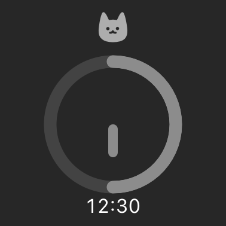
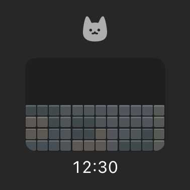
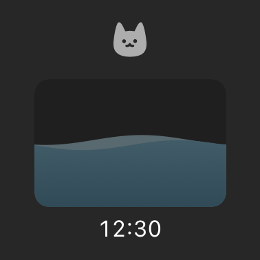

# Timer styles in widgets and Live Activities

Local candidate: **NeowFocus iOS 0.1.1 (15)**. The currently delivered TestFlight build remains **0.1.1 (14)**. No upload or public submission was performed for this candidate. The signed Simulator Release app was rebuilt after duck-boat removal and installed in a dedicated QA simulator for host validation.

## Behavior

- The existing `timerStyle` and `showRemainingTime` settings now travel through the native snapshot to the home widget, Lock Screen Live Activity and Dynamic Island.
- Classic retains its existing ring. Blocks use a compact 12×8 exact-cover board derived from the incumbent mobile tile. Water uses two blue-gray surfaces; the duck boat and its passenger have been removed.
- Default/unknown/old snapshots resolve to classic. Optional native fields preserve old Codable payloads. Completion pins the last active style. Idle previews follow preference changes. Pause/resume and queued native commands retain appearance preferences.
- New blocks transition in for 0.32s; water levels transition for 0.45s. Both disable movement for Reduce Motion and reduced-luminance Always-On. No repeatForever, custom timer-font hack, frame loop or new background execution mode is used.
- Artwork is a **snapshot**, not an autonomous background animation. Home-widget timeline delivery is owned by iOS; the existing minute entries are requests, not a guaranteed refresh rate. While foreground/running, themed artwork is republished at most once per wall-clock minute and on lifecycle/state/preference changes. Completed/paused sessions do not receive periodic artwork updates.
- A suspended app cannot guarantee custom Live Activity artwork updates. The last artwork snapshot can remain visible while Apple's native `ProgressView(timerInterval:)` and optional timer text continue to advance. Pause/resume, foreground reconciliation or other valid state updates catch the artwork up. No server/push animation service was introduced.
- Existing task-visibility privacy, widget controls, day count, app links and app-side timer scene remain in place. Publication reads current settings after native command replay, avoiding stale queued preference values.

## Verified

- Mobile TypeScript and `test:timer-styles` checks, including idle preference changes and completion style retention.
- Actual iOS Swift model executable: legacy JSON decoding, new-field round trip, completion/pause preservation, invalid progress inputs, **24 physically droppable tetrominoes covering all 96 cells**.
- iOS Simulator Release build and SwiftUI widget/card type checking.
- Offscreen rendering of the **production** `FocusWidgetContent`, `FocusLiveCard` and artwork in the iOS runtime. Selected paused and completed references are attached below. This is not a SpringBoard or Lock Screen screenshot.
- New native artwork was inspected at 25%, 50% and 100%; small/medium layouts and large Dynamic Type were inspected offscreen. The mechanical design detector returned no findings for the changed Swift files.

## Actual iOS host validation after Mac unlock

On 2026-10-23, the signed 0.1.1 (15) candidate from `e44a5c7` was installed in a separate **NeowFocus Widget QA / iPhone 18 Pro / iOS 27.0 Simulator**. Existing Calendar test devices and data were left alone. The test used a local task named `123`; iCloud/calendar sync and lock-screen task visibility remained off.

- Added the small home widget through the native gallery. Water completion, running blocks and the existing classic ring displayed in SpringBoard.
- Running blocks and classic displayed in the compact Dynamic Island.
- Water displayed in the actual Lock Screen Live Activity while running, paused, resumed and completed. The original paw appeared over the water on completion. No duck boat or yellow unsupported-view placeholder appeared in these host views.
- Paused from the app's two-button bottom sheet: the Lock Screen card retained **14:34** across lock/unlock and a style change. Resuming in the app restarted the countdown and restored the running card.
- Both five-minute sessions naturally finished while validating the views. The final longer QA session was manually ended after pause/resume checks; its completion card retained water.
- Fresh simulator registration and the Live Activity permission prompts initially delayed the card. After registration and permission acceptance, host content rendered and the countdown advanced. The first running capture includes initial cached timer content; use the later observations and paused-state capture for state comparison.

Host screenshots (actual Simulator UI, distinct from the offscreen references below):

- [Water running](host/water-lock-screen.png), [paused](host/water-paused-lock-screen.png), [completed](host/water-completed-lock-screen.png)
- [Blocks home widget and compact Dynamic Island](host/blocks-home-and-island.png)
- [Classic home widget and compact Dynamic Island](host/classic-home-and-island.png)

## Still pending

CUA coordinate clicks/drags repeatedly returned `noWindowsAvailable`; accessibility controls and native menus worked. Direct widget intent-button taps, expanded Dynamic Island gestures, medium-widget host layout, animation playback, Reduce Motion and physical-device Always-On behavior remain **unverified**. The app-driven pause/resume checks above do not establish widget-button interaction. No physical-device test or TestFlight upload is claimed.

The fresh simulator also showed an initial notification-scheduling warning. Permission was subsequently granted, but the old warning remained visible in the app. This timer-style validation does not establish completion notification delivery.

`ImageRenderer` cannot render system timer progress views: running-state captures show a yellow unsupported-view placeholder, including the pre-existing classic progress view. Do not treat those offscreen captures as a running WidgetKit test. Paused/completed view captures avoid this unsupported renderer path. The renderer also emits `IOSurfaceClientSetSurfaceNotify failed e00002c7` in this headless CLI context but completes with exit 0 and writes PNGs.

## Reproduce

From `apps/mobile`, supply an explicit booted iOS Simulator UDID (several simulators may be running):

```sh
pnpm typecheck
pnpm test:timer-styles
pnpm test:widget-styles <UDID>
bash scripts/render-widget-style-previews.sh <UDID>
```

The preview helper replaces only the WidgetBundle `@main` annotation in an ignored build copy; production view bodies remain identical. Output is under `build-output/WidgetStyleTests/Previews`. Native build logs are `build-output/widget-styles-final-simulator-build.log`; model and preview logs are `widget-styles-model-tests.log` and `widget-styles-preview-script.log`.

## Reference images — offscreen components only

| Classic, paused | Blocks, paused | Water, paused |
|---|---|---|
|  |  |  |

- [Paused Live Activity card](paused-water.png)
- [Completed Live Activity card](completed-water.png)

## Apple references

- [Animating data updates in widgets and Live Activities](https://developer.apple.com/documentation/widgetkit/animating-data-updates-in-widgets-and-live-activities)
- [Keeping a widget up to date](https://developer.apple.com/documentation/widgetkit/keeping-a-widget-up-to-date)
